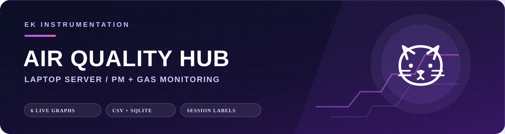
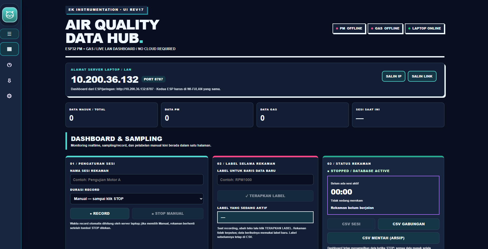
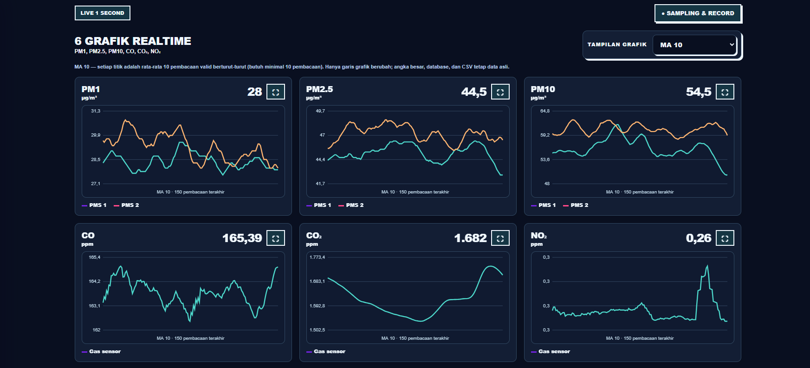
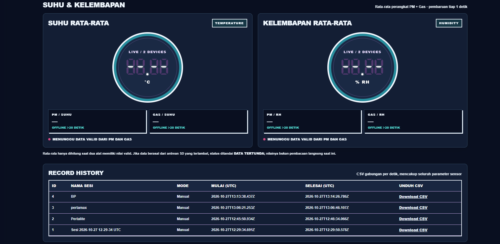
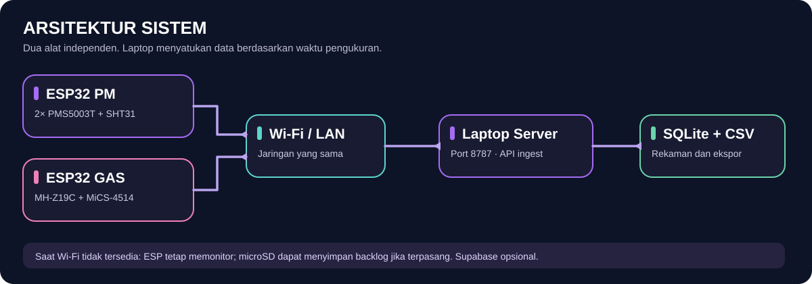

**Website resmi:** [**EK Instrumentation — ek-instrumentation.com**](https://ek-instrumentation.com)

<p align="center">
  
</p>

<p align="center">
  <a href="https://github.com/efendiyhy/pmgas-esp32-firmware">ESP32 Firmware Installer</a> ·
  <a href="https://ek-instrumentation.com">Company Website</a>
</p>

# EK Air Quality Hub — Laptop Server

**Aplikasi monitoring kualitas udara berbasis laptop** untuk menerima dan menyatukan data dari dua perangkat ESP32 independen: **Particulate Matter (PM)** dan **Gas**. Dashboard bekerja di jaringan lokal, menampilkan pembacaan realtime, dan menyediakan pencatatan terstruktur untuk pengujian serta analisis data.

**Platform:** Windows 10/11 · **Runtime:** Python 3.9+ · **Server:** HTTP port `8787` · **Penyimpanan:** SQLite + CSV lokal


## Galeri Dashboard

<p align="center">
  <a href="assets/github/ss1.png">
    
  </a>
</p>
<p align="center">
  <strong>Gambar 1.</strong> Dashboard utama EK Air Quality Hub.
</p>

<p align="center">
  <a href="assets/github/ss2.png">
    
  </a>
</p>
<p align="center">
  <strong>Gambar 2.</strong> Visualisasi grafik realtime parameter PM dan gas.
</p>

<p align="center">
  <a href="assets/github/ss3.png">
    
  </a>
</p>
<p align="center">
  <strong>Gambar 3.</strong> Monitoring suhu dan kelembapan rata-rata dari kedua perangkat.
</p>

## Instalasi cepat

Buka **Windows PowerShell**, kemudian jalankan:

```powershell
irm https://raw.githubusercontent.com/efendiyhy/pmgas-merge/main/install.ps1 | iex
```

Installer mengunduh versi aplikasi dari repository, menyiapkan Python jika diperlukan, dan membuat shortcut **EK Air Quality Hub** di Desktop/Start Menu. Internet diperlukan saat instalasi; pengukuran melalui LAN tidak memerlukan layanan cloud.

> **Keamanan:** Perintah `irm | iex` menjalankan kode PowerShell dari internet. Periksa [`install.ps1`](install.ps1) terlebih dahulu dan jalankan hanya dari repository yang dipercaya.

### Menjalankan aplikasi

1. Klik shortcut **EK Air Quality Hub**.
2. Biarkan jendela **terminal server** tetap terbuka. Dashboard terbuka di browser pada **http://localhost:8787**.
3. Untuk menghentikan server, tekan `Ctrl+C` di terminal atau tutup jendela terminal. Menutup browser saja **tidak** menghentikan server.

**STOP** di Dashboard menghentikan *sesi Record*, **bukan** layanan server maupun penyimpanan data otomatis.

## Arsitektur sistem

<p align="center">
  
</p>

Sumber data tetap terpisah: ESP32 PM membaca sensor partikulat, sedangkan ESP32 Gas membaca sensor gas. Laptop menerima keduanya melalui **`POST /api/ingest`** dan menyediakan ekspor CSV gabungan. Penggabungan dilakukan berdasarkan **timestamp pengukuran**, bukan berdasarkan urutan paket diterima.

## Menghubungkan ESP32 ke laptop

1. Sambungkan laptop dan **kedua ESP32** ke Wi-Fi/LAN yang sama.
2. Jalankan server. Pada Dashboard, lihat kartu **Alamat Server Laptop / LAN** dan salin **IP IPv4** yang sesuai dengan jaringan ESP32.
3. Buka dashboard masing-masing ESP32 (`http://192.168.4.1` saat terhubung ke hotspot ESP), masuk ke pengaturan **Laptop Server**, lalu masukkan **IP saja** — misalnya `192.168.1.100`.
4. Aktifkan pengiriman ke laptop pada kedua alat. Firmware membentuk alamat `http://192.168.1.100:8787/api/ingest` secara otomatis.
5. Jika Windows Firewall meminta izin, izinkan Python pada jaringan **Private**. Jangan mengekspos port `8787` ke internet publik.

**Perhatian:** `localhost` / `127.0.0.1` hanya berlaku di laptop itu sendiri dan **bukan** alamat yang bisa dipakai ESP32 untuk mengirim data.

## Fitur

| Modul | Kemampuan |
| --- | --- |
| **Dashboard** | Enam grafik PM1, PM2.5, PM10, CO, CO₂, dan NO₂; pembaruan tampilan sekitar 1 detik. |
| **Tampilan grafik** | Data Asli, MA 10, MA 20, MA 50, MA 100; hanya memengaruhi grafik, bukan data CSV. |
| **Grafik pop-up** | Perbesar setiap grafik dan lanjutkan pembaruan realtime. |
| **Suhu & kelembapan** | Dua widget digital berbentuk lingkaran; rata-rata pembacaan PM dan Gas jika keduanya tersedia dan valid. |
| **Sampling & Record** | Nama sesi, mode manual atau durasi otomatis, Stop, serta pergantian label tanpa menghentikan sesi. |
| **Riwayat & ekspor** | CSV sesi, CSV gabungan per waktu pengukuran, dan CSV mentah untuk audit. |
| **Antarmuka** | Sidebar dengan logo kucing yang dapat diperkecil; enam tema (Brutal Light/Dark, Modern Light/Dark, Scientific, Midnight). |
| **Pengaturan** | Informasi LAN, pengelolaan data lokal, dan penghapusan berkonfirmasi. |

### Label saat sesi masih berjalan

Contoh sesi **Uji Emisi Motor A**: mulai dengan label `RPM1000`, lalu saat kondisi berubah ketik `RPM2000` dan klik **Terapkan Label**. Sesi **tidak berhenti**; baris yang dicatat berikutnya memakai label baru.

> **Penting:** Semua paket yang diterima disimpan sebagai data mentah dalam SQLite meskipun Record belum dimulai. Mode Record memberi metadata sesi dan label. Bila ESP mengirim *backlog* microSD, label yang aktif saat data diterima dapat melekat pada data tertunda. Untuk analisis yang membutuhkan label tepat menurut waktu eksperimen, pastikan pengiriman realtime dan sinkronisasi jam perangkat.

### CSV gabungan

Data PM dan Gas ditempatkan dalam satu baris untuk **detik pengukuran yang sama**. Bila salah satu alat tidak memiliki pengukuran pada detik itu, kolomnya tetap kosong. File mentah mempertahankan identitas perangkat untuk audit; ekspor gabungan tidak memerlukan kolom device.

## Penyimpanan lokal

Semua hasil tersimpan di satu lokasi:

```text
%LOCALAPPDATA%\EKInstrumentation\LaptopServer\
├── server.py
├── index.html
├── launch.ps1
├── assets\
└── data\
    ├── monitoring.sqlite3
    ├── records\
    ├── logs\
    └── legacy_backup\     (jika ada)
```

**Folder `data/` dipertahankan ketika installer diperbarui.** Sebelum migrasi besar atau menghapus aplikasi, buat salinan data terlebih dahulu. Data di microSD ESP32 dan Supabase tidak menjadi bagian dari folder ini.

## Memperbarui aplikasi

1. Jika sedang merekam, tekan **STOP** pada sesi Record.
2. Tutup terminal server untuk menghentikan Python.
3. Jalankan kembali perintah instalasi PowerShell di atas.
4. Buka ulang shortcut aplikasi, kemudian gunakan `Ctrl+F5` jika browser masih menampilkan cache lama.

> Pembaruan aplikasi tidak sama dengan update firmware ESP32. Firmware PM/Gas dikelola terpisah di [pmgas-esp32-firmware](https://github.com/efendiyhy/pmgas-esp32-firmware).

## Uninstall

Hentikan sesi Record, tutup terminal, lalu jalankan:

```powershell
& "$env:LOCALAPPDATA\EKInstrumentation\LaptopServer\uninstall.ps1"
```

Uninstaller menghapus shortcut dan file aplikasi, namun **mempertahankan `data/`** agar rekaman tidak hilang. Jika benar-benar ingin menghapus seluruh rekaman, gunakan menu Pengaturan ketika server aktif atau hapus folder data secara manual **setelah melakukan backup dan menghentikan server**.

## Keamanan data

- Gunakan server hanya pada **jaringan lokal tepercaya**; tidak disiapkan sebagai layanan HTTP publik.
- Menu **Hapus Semua Data Lokal** hanya diizinkan dari `localhost`; memerlukan frasa konfirmasi dan password. Password bawaan `ekinstru` harus diganti untuk pemakaian rutin melalui variabel lingkungan `EK_DELETE_PASSWORD`.
- Penghapusan lokal **tidak** menghapus data pada microSD ESP32 atau Supabase. Selama ESP masih terhubung, pengukuran baru dapat masuk kembali.
- Jangan menyimpan token perangkat, password Wi-Fi, kredensial sensitif, database, atau ekspor CSV pribadi di repository GitHub publik.

## Pemecahan masalah

| Masalah | Pemeriksaan |
| --- | --- |
| Dashboard tidak dapat dibuka | Pastikan terminal server masih berjalan; akses `http://localhost:8787`. |
| ESP tidak mengirim data | Pastikan Wi-Fi sama, IP laptop benar, firewall Private mengizinkan TCP `8787`, dan fitur LAN ESP aktif. |
| Grafik tampak tertunda | Periksa apakah ESP sedang mengunggah antrean microSD. Refresh UI 1 detik tidak menjamin paket baru tiba 1 detik. |
| CSV gabungan berisi kolom kosong | Cocokkan jam/timestamp PM dan Gas; jangan memasangkan data hanya menurut waktu terima. |
| Instalasi gagal mencari Python | Gunakan Python 3.9+ yang berfungsi; periksa `py -0p` atau perbaiki instalasi Python. |
| Tema/fitur baru belum muncul | Pastikan `index.html` terbaru sudah berada di repository, instal ulang, lalu tekan `Ctrl+F5`. |

## Menjalankan dari source

```powershell
python server.py
```

Buka `http://localhost:8787`. Backend memakai pustaka standar Python; instalasi manual ini tidak membuat shortcut Windows.

---

<p align="center">
  <a href="https://ek-instrumentation.com"><strong>EK Instrumentation</strong></a><br/>
  <sub>Environmental Monitoring · Embedded Systems · Data Acquisition</sub><br/>
  <a href="https://github.com/efendiyhy/pmgas-esp32-firmware">Firmware ESP32</a> · <a href="https://github.com/efendiyhy/pmgas-merge">Laptop Server</a>
</p>
